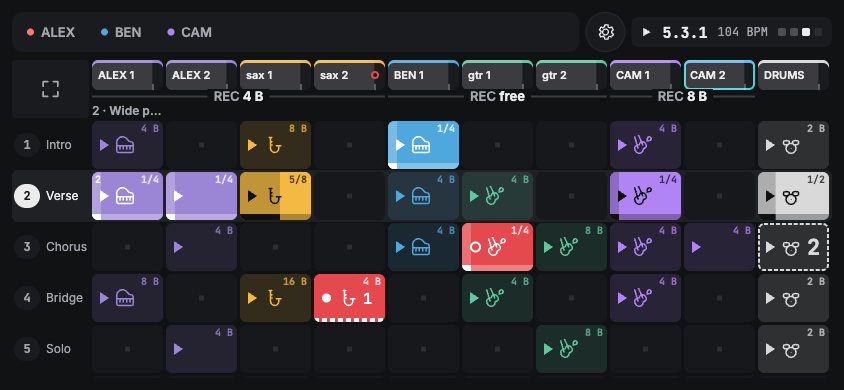
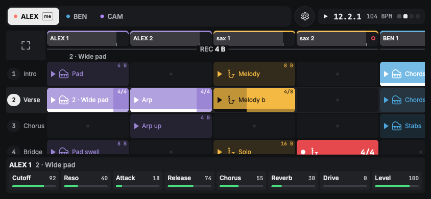
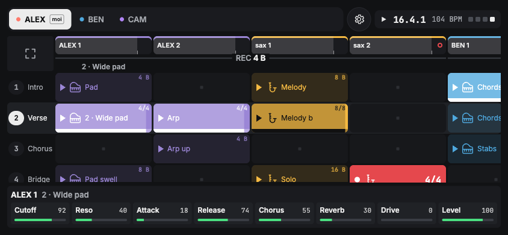

# session-viewer

A read-only session view for your band's phones, for Ableton Live.

Each musician opens a web page on their phone and sees the clips of their own tracks: what plays, what is
recording, how long a take is, which chain is active, and the knobs' macros. Nothing is ever triggered in Live
from the phone.

It was built for a band that jams in Live's Session View with several people on stage, each on their own tracks.

> Ableton and Live are trademarks of Ableton AG. This project is not affiliated with or endorsed by Ableton.

<p align="center">
  
</p>
<p align="center">
  
</p>

Each musician gets their own tabs and tracks, and a panel with the macros their knobs drive. The interface also comes
in French:

<p align="center">
  
</p>

## What you need

- Ableton Live 11 or later, on the computer that runs the set.
- Node.js 22.12 or later (`.nvmrc` pins 24).
- The [AbletonJS](https://github.com/leolabs/ableton-js) remote script, installed in Live (see below).
- Phones and the computer on the same network. The page is served over plain HTTP.

## Install and run

```bash
npm install
npm run setup:live        # copies the AbletonJS remote script into Live's User Library
npm run build
npm start                 # port 3000, PORT=… to change it
```

`setup:live` expects the default User Library (`~/Music/Ableton/User Library` on macOS,
`~/Documents/Ableton/User Library` on Windows). If yours is elsewhere (Live's Settings > Library):

```bash
npm run setup:live -- "/path/to/User Library"
```

You can also copy `node_modules/ableton-js/midi-script` by hand to `Remote Scripts/AbletonJS` in the User Library,
or into the `User Remote Scripts` folder of Live's preferences (its location depends on the Live version).

Then in Live: Settings > Link, Tempo & MIDI > Control Surface > **AbletonJS**. Restart Live if it is not listed.

The server prints the addresses to open (`on your network: …`). They are also shown in the app, under
Settings > "Connect a phone", with a QR code.

Want to look around first? `npm run build && npm run demo` serves a made-up set, with no Live needed, on its own
settings in `data/demo/`.

## Musicians

The screen is built from a list of **musicians**, set in the app's settings and shared by every phone:

- a name;
- the run of tracks their tab jumps to, from a first to a last track. Tracks are matched **by name**, so renaming a
  track in Live shows up as a warning in the settings, with a suggestion;
- optionally a colour, a cue return, racks whose macros their knobs drive, and an icon per track.

On a phone, "I am" picks your tab. Settings can be locked for a concert so nobody changes them by accident.
Settings belong to the Live project that is open: they are stored in `SessionViewer/settings.json` inside the
project folder, next to `Ableton Project Info`, and shared by every set of that project. A project opened for the first
time starts from a copy of the global settings (`data/settings.json`), which a set never saved also uses. The
settings screen shows which project they belong to.

## On the phone

- **iPhone**: open the address in Safari, then Share > Add to Home Screen. The icon opens the app without browser
  bars. It keeps the address it was installed from: if the computer's IP differs between home and rehearsal room,
  install one icon per place.
- **Android**: open the address and use the fullscreen button at the top left of the grid. To install it as an app
  over HTTP, add the address in `chrome://flags` > "Insecure origins treated as secure".
- **Network**: a phone app on the home screen follows iOS's network choice. At home (a router with internet), Wi-Fi
  plus mobile data works. In a rehearsal room (a router without internet), switch to airplane mode, then turn Wi-Fi on.
- **Screen stays on**: the Wake Lock API needs HTTPS, so the page plays a silent looping video instead.

### "Server unreachable"

The banner shows the address the app tried and the reason of the last failure.

1. Is it the computer's address on this network? An icon installed elsewhere keeps the old one.
2. Is the phone on the right Wi-Fi, in the right mode (see above)?
3. Is the server running? The terminal prints `[http] page loaded by <phone IP>` at each page load. If nothing
   appears, the request does not reach the computer.
4. Does the address open in the phone's browser? If yes, the problem is the app's network: go back to point 2.

## Configuration

Environment variables, or a `.env` file at the root of the project (copy `.env.example`; a variable already set in
your shell wins over the file):

| Variable | Default | Meaning |
| --- | --- | --- |
| `PORT` | `3000` | Port of the server |
| `REC_LENGTH_DIR` | `data/rec-length` | Folder of the record-length files |
| `REC_LENGTH_WRITERS` | none | Scripts that write them, to warn when one writes elsewhere |
| `USER_ACTIONS_DIR` | Live's `_user_actions` folder | Where those scripts are looked up |

## Optional integrations

Some features read information that Live does not expose by itself. They are all optional and off by default:

- **Record length** per musician, read from small JSON files written by any tool (a Max device, a script, ClyphX…).
- **Chain label and macro panel**, following the chain selected by a rack macro of your choice.
- **Cue**, **Overdub** highlight, **effect flags**.

The formats are in [docs/integrations.md](docs/integrations.md).

## Limits

- Display only: it reads Live through AbletonJS and sends nothing back.
- HTTP on the local network, no authentication. Anyone on that network can open the page and, unless locked,
  change the shared settings. Do not expose the port to the internet.
- The global settings and rec lengths live in `data/`, which is not versioned. Project settings live in each project.

## Development

```bash
npm test          # vitest
npm run check     # tsc + svelte-check
npm run dev       # server in watch mode
npm run dev:web   # vite
npm run probe     # traces Live's events
npm run probe:macros -- "<track>"      # traces the macro changes of a rack
npm run probe:midi -- <musician>      # traces notes and meters of a musician's tracks
```

The interface is available in English and French. It follows the phone's language, or `?lang=fr` / `?lang=en`.
Texts live in `web/src/lib/i18n/`.

## Credits

- Talks to Live through [ableton-js](https://github.com/leolabs/ableton-js) (MIT).
- Fonts: Inter and JetBrains Mono, SIL Open Font License (`web/public/fonts/LICENSES.txt`).
- `web/public/keep-awake.mp4` is a tiny silent video generated with ffmpeg, the technique used by NoSleep.js.

## License

[MIT](LICENSE)
